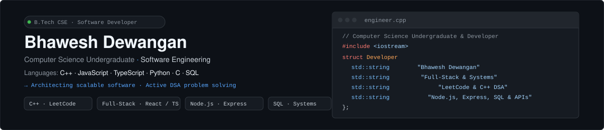
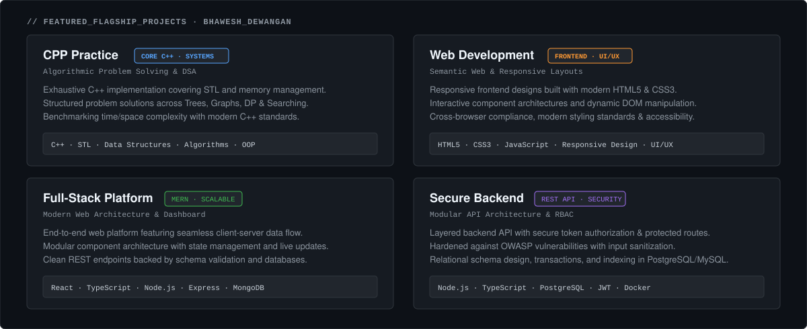

  

    

  
  
  
  

---

### 👨‍💻 About Me

> **Computer Science undergraduate building resilient full-stack architectures, solving complex algorithmic challenges in C++, and engineering scalable software systems.**

I'm a Computer Science & Engineering undergraduate passionate about high-performance software engineering, modern web architectures, and verifiable systems programming. My technical focus spans across modular full-stack web applications, structured backend API systems with relational and document databases, rigorous algorithmic problem solving in modern C++, and secure software design principles.

---

### 🏛️ Core Identity Pillars

| 1. Full-Stack &amp; Web Systems | 2. Advanced DSA &amp; Systems | 3. Backend &amp; Architecture | 4. Applied AI &amp; Security |
|:---|:---|:---|:---|
| • Responsive Component Architectures • React &amp; TypeScript Ecosystem • Session Authorization &amp; State Management • RESTful Client-Server Communication | • Modern C++ &amp; STL Containers • Algorithmic Problem Solving (DSA) • Time &amp; Space Complexity Optimization • Graph Traversal, DP &amp; Backtracking | • Layered REST API Architecture • Node.js &amp; Express Services • Relational Schema Design &amp; SQL • Hardened JWT RBAC Authorization | • LLM &amp; AI Integration Workflows • Strict Schema Validation &amp; Sanitization • Defensive Programming Patterns • Containerized Environments (Docker) |

---

### 🛠️ Skills & Technologies

| Category | Technologies &amp; Tools |
|---|---|
| **Core Languages** | `C++` &nbsp;•&nbsp; `JavaScript (ES6+)` &nbsp;•&nbsp; `TypeScript` &nbsp;•&nbsp; `Python` &nbsp;•&nbsp; `C` &nbsp;•&nbsp; `SQL` &nbsp;•&nbsp; `HTML5 / CSS3` |
| **Frontend &amp; Web** | `React` &nbsp;•&nbsp; `TypeScript` &nbsp;•&nbsp; `Tailwind CSS` &nbsp;•&nbsp; `HTML5` &nbsp;•&nbsp; `CSS3 / Flexbox / Grid` &nbsp;•&nbsp; `Responsive UI/UX` |
| **Backend &amp; Databases** | `Node.js` &nbsp;•&nbsp; `Express.js` &nbsp;•&nbsp; `PostgreSQL` &nbsp;•&nbsp; `MongoDB` &nbsp;•&nbsp; `MySQL` &nbsp;•&nbsp; `RESTful APIs` &nbsp;•&nbsp; `JWT Authentication` |
| **Developer Tools &amp; CI** | `Git` &nbsp;•&nbsp; `GitHub` &nbsp;•&nbsp; `VS Code` &nbsp;•&nbsp; `Docker` &nbsp;•&nbsp; `Postman` &nbsp;•&nbsp; `Linux / Bash` &nbsp;•&nbsp; `GCC / Clang` |

---

### 🚀 Featured Projects

  

 

| Project | Description | Tech Stack | Links |
|:---|:---|:---|:---:|
| **[CPP Practice](https://github.com/dewanganbhawesh07-cpu/CPP)** | **Comprehensive C++ practice and algorithms collection.** Features structured implementations of Object-Oriented Programming principles, Standard Template Library (STL) containers, pointer manipulation, and foundational Data Structures (Trees, Graphs, Sorting, Searching). | `C++` `STL` `OOP` `Data Structures` `Algorithms` |  |
| **[Web Development Showcase](https://github.com/dewanganbhawesh07-cpu/HTML)** | **Practical web development and frontend project collection.** Demonstrates responsive web layouts, semantic HTML5 structure, modern CSS3 styling paradigms (Flexbox, CSS Grid), interactive DOM manipulation, and cross-browser compatibility. | `HTML5` `CSS3` `JavaScript` `Responsive Design` `UI/UX` |  |
| **[Cloud-Native Full-Stack Platform](https://github.com/dewanganbhawesh07-cpu)** | **Scalable full-stack web application with modular component architecture.** Features end-to-end client-server data flow, responsive dashboard interfaces, protected routes, and clean RESTful API integration. | `React` `TypeScript` `Node.js` `Express` `MongoDB` |  |
| **[Secure Backend & Auth Service](https://github.com/dewanganbhawesh07-cpu)** | **Layered backend microservice with role-based JWT authentication.** Features password encryption, protected endpoint authorization, input sanitization against OWASP vulnerabilities, and relational PostgreSQL database schema design. | `Node.js` `TypeScript` `PostgreSQL` `JWT` `Docker` |  |
| **[studious-waddle](https://github.com/dewanganbhawesh07-cpu/studious-waddle)** | **Exploratory codebase for prototyping and tooling experimentation.** Testbed repository used for testing emerging architectural patterns, CI workflows, and software engineering experimentation. | `Software Engineering` `Git` `Developer Tooling` |  |

---

### 💻 Problem Solving & Algorithmic Practice

- **[CPP Repository (Core DSA & Algorithms)](https://github.com/dewanganbhawesh07-cpu/CPP)** — Structured C++ implementations covering arrays, linked lists, stacks, queues, recursion, binary trees, sorting algorithms, and STL container benchmarks.
- **[Web Development Lab Work](https://github.com/dewanganbhawesh07-cpu/HTML)** — Practical exercises in semantic layout design, DOM event handling, interactive form validations, and CSS responsive units.
- **Algorithmic Problem Solving (LeetCode / DSA)** — Regular practice with algorithmic patterns including Two Pointers, Sliding Window, Fast & Slow Pointers, Depth-First Search, Breadth-First Search, and Dynamic Programming.
- **Systems & Computing Foundations** — Hands-on understanding of memory hierarchies, pointer arithmetic, stack vs heap allocation, and structured database normalization.

---

### 📫 Get In Touch

  **Open to software engineering internships, technical mentorship, and systems/backend collaborations.**

   

  
  &nbsp;&nbsp;
  
  &nbsp;&nbsp;
  

    
  © 2026 Bhawesh Dewangan • Computer Science & Engineering Undergraduate

